# Publicar versiones verificadas en el VPS

La [Issue #143](https://github.com/xbasets82/Nextriva/issues/143) preparó la publicación manual de la instalación `nextriva-demo`. La [Issue #163](https://github.com/xbasets82/Nextriva/issues/163) añadió un despachador posterior al CI que está **deshabilitado por defecto** y solo solicita el workflow manual existente cuando `NEXTRIVA_CD_AUTO_ENABLED=true` y `NEXTRIVA_CD_MANUAL_ENABLED=true`.

**Estado operativo comprobado el 29 de octubre de 2026:** ambas variables del repositorio están en `true`. El CI de `main` para `8c3d27acbe36e5ddd205b976f436e81a8e55d17b` terminó correctamente. Su evento `workflow_run` (ejecución `40878203230`) fue omitido antes de activar el automatismo; cambiar la variable no vuelve a disparar ejecuciones anteriores. Aún falta observar un despacho automático iniciado por un CI posterior a la activación. Este documento conserva el procedimiento de configuración inicial; verificá el estado real de GitHub y la VPS antes de repetir cualquier paso.

## Estado y recorrido

El CI existente continúa ejecutando calidad/build, unitarias/cobertura, integración, E2E y auditoría. `auto-deploy.yml` recibe `workflow_run` completados del workflow `CI` en `main`, pero el job queda omitido salvo que ambas variables anteriores estén activadas. Antes de solicitar el workflow manual, verifica por API el evento push, repositorio, rama, SHA actual de `main`, conclusión y los seis jobs requeridos. El token del despachador tiene únicamente `contents:read` y `actions:write`; no recibe secretos SSH ni permiso de paquetes. `deploy.yml` vuelve a comprobar el CI y el SHA exacto antes de publicar y antes de modificar aplicaciones. Si `main` avanzó, el flujo anterior se rechaza.

El marcador interno `expected_sha=current` solo se acepta en el gate cuando GitHub identifica al actor como `github-actions[bot]`; las ejecuciones manuales hechas por una persona requieren confirmar el SHA estable explícito. El dispatcher usa su propio grupo. Todos los workflows de publicación manual y automática comparten `nextriva-public-deployment` con `queue: max`, evitando que una ejecución pendiente sustituya a otra (hasta 100 en espera; GitHub no garantiza orden FIFO y cancela ejecuciones adicionales si se llena la cola). El bloqueo exclusivo del helper del VPS sigue siendo la protección final contra mutaciones simultáneas: un segundo intento que coincide con una operación activa falla seguro y puede reintentarse.

```mermaid
flowchart LR
  PR[PR] --> CI[CI sin secretos de producción]
  CI --> M[Merge autorizado a main]
  M --> C[CI push del SHA exacto]
  C --> AUTO[workflow_run validado; apagado por defecto]
  AUTO --> D[Solicita workflow_dispatch existente]
  D --> G[Guardas main + CI + jobs]
  G --> I[Reutilizar tag/SHA y digest existente o publicar si falta]
  I --> S[SSH con host key fijada]
  S --> H[Helper fijo del operador + bloqueo]
  H --> P[Comprobar esquema sin migrar]
  P --> ACT[Actualizar solo API y web]
  ACT --> V[Salud + HTTPS + revisión]
  V --> R[Estado estable o recuperación de aplicación]
```



El workflow separado de `workflow_run` se ejecuta con la versión confiable de `main` y no consume artefactos o código de PR. En vez de contener credenciales de producción, su token solo solicita `workflow_dispatch` para `deploy.yml`; GitHub documenta que este evento puede iniciar otro workflow usando `GITHUB_TOKEN` ([documentación oficial](https://docs.github.com/en/actions/how-tos/write-workflows/choose-when-workflows-run/trigger-a-workflow)). Ese workflow conserva sus guardas, serialización, verificación exacta y SSH restringido. `workflow_run` usa `GITHUB_SHA` del último commit de la rama por defecto, por lo que el despachador toma el SHA del CI desde la ejecución origen, verifica que siga siendo el HEAD de `main`, y lo pasa al dispatch. Si la rama avanza después de la verificación, el gate del workflow manual lo rechaza.

La publicación consulta primero la etiqueta `:<SHA>` en GHCR. Si existe, la descarga, comprueba la etiqueta OCI `org.opencontainers.image.revision` y reutiliza el digest resuelto; si está ausente, construye y publica y luego verifica la revisión. Un error de autenticación/red no se interpreta como etiqueta ausente. Esto vuelve idempotente el reintento desde el pipeline y evita reconstruir/mover una etiqueta ya encontrada; los digests reales continúan siendo la identidad usada para el despliegue. La protección no impide que una persona con permisos de escritura mueva manualmente una etiqueta en GHCR: mantener acceso de escritura restringido sigue siendo necesario.

## Comprobación local

Desde la raíz, con las herramientas fijadas y Docker disponibles:

```sh
mise exec -- pnpm test:cd
mise exec -- pnpm test:cd:postgres
mise exec -- pnpm --filter @nextriva/api test:e2e:production
mise exec -- pnpm exec prettier --check .github/workflows/deploy.yml scripts/cd-*.mjs scripts/test-cd-postgres.mjs
mise exec -- pnpm exec eslint scripts/cd-*.mjs scripts/test-cd-postgres.mjs
```

`test:cd` prueba políticas, coordinación y adaptadores locales. `test:cd:postgres` mantiene PostgreSQL real desechable sin puertos ni red, con datos/relaciones sintéticos, mientras simula la activación de aplicaciones: **no prueba un reemplazo Compose real ni una conexión SSH real**. Usa tmpfs, nombre aleatorio y limpieza exclusiva de su contenedor. El E2E de artefacto existente sí construye API/web/PostgreSQL reales y comprueba HTTPS/cookie/CSRF y aprobación independiente; rechaza CI y conexiones heredadas. Ningún comando usa `nextriva_dev`.

## Preparación remota: checklist de referencia

Esta sección conserva la checklist de configuración inicial; no representa una lista vigente de tareas pendientes. La configuración y el primer despliegue manual se realizaron con autorización previa. Antes de repetir operaciones, verifica el estado actual: esta guía no sustituye un inventario reciente de Compose/env, rutas, propietarios, red/proxy, ID de PostgreSQL, volumen ni referencias API/web. No asumas una ruta de release por su nombre.

1. Confirmar la instalación pública existente: proyecto `nextriva-demo`, servicios `api`, `web`, `postgres`; binds `127.0.0.1:3100:3000` y `127.0.0.1:8180:8080`; volumen lógico `demo_database`. El nombre Docker efectivo y el ID de PostgreSQL se fijan al inventariar. Caddy, certificados, DNS, firewall y base permanecen administrados por los procedimientos existentes.
2. Revisar/copiar la configuración Compose actual a un directorio del operador no escribible por el usuario SSH. Conservar todas sus rutas absolutas y parámetros actuales; no sustituir por `compose.production.yaml`. El helper combina esa copia con un override JSON que contiene únicamente las imágenes de API/web. El `.env` de Compose debe contener las variables que exige el archivo, incluidos los perfiles inactivos. No incluir secretos en una ruta del checkout ni en los artifacts.
3. Verificar Node 24.22.0 en `/usr/bin/node`, Docker en `/usr/bin/docker`, Compose con `--wait`, conectividad HTTPS saliente y al menos 2 GiB libres. Son prerrequisitos propuestos, no instalaciones comprobadas en el VPS por esta tarea. Mantener espacio para ambas versiones y no ejecutar limpiezas generales de imágenes/volúmenes.
4. Instalar los módulos `scripts/cd-server.mjs`, `cd-runtime.mjs`, `cd-deploy.mjs` y `cd-policy.mjs` juntos en `/usr/local/libexec/nextriva-cd/`, propiedad root y sin escritura de grupo/otros. Configuración en `/etc/nextriva-cd/config.json`; estado en un directorio separado, por ejemplo `/var/lib/nextriva-cd`, root 0700. Estas rutas son **nuevas propuestas**, no un inventario del servidor.
5. Crear el usuario exclusivo `nextriva-deploy`, sin grupo Docker, acceso a secretos runtime ni sudo general. Su clave `authorized_keys` debe ser propiedad root fuera de su HOME y limitarse a `restrict,command="/usr/bin/sudo -n /usr/bin/node /usr/local/libexec/nextriva-cd/cd-server.mjs"`. Debe denegarse acceso por contraseña, forwarding, PTY y cambio del archivo autorizado. Validar la configuración SSH y sudoers antes de aplicarla, conservando la sesión administrativa actual.
6. El único permiso sudo propuesto es `nextriva-deploy ALL=(root) NOPASSWD: /usr/bin/node /usr/local/libexec/nextriva-cd/cd-server.mjs`. La ruta/argumentos son constantes y el servidor rechaza argumentos adicionales. Revisar con `visudo -cf` antes de instalar. El helper requiere root porque controla Docker, pero el usuario remoto no puede elegir un binario, comando, fichero Compose, volumen ni argumentos Docker. No recibe un shell root.
7. Revisar el acceso a los paquetes `nextriva-api` y `nextriva-web` de GHCR. Si ya existen, ambos deben ser privados y estar vinculados a `xbasets82/Nextriva` antes de cualquier publicación. La [Issue #145](https://github.com/xbasets82/Nextriva/issues/145) permite su creación inicial únicamente cuando la consulta devuelve HTTP 404: el primer push del workflow autorizado crea el paquete, cuya visibilidad inicial en GHCR es privada. La publicación desde Actions con `GITHUB_TOKEN` lo vincula al repositorio. Después de **cada push**, el cliente vuelve a comprobar que el paquete existe, es privado y está vinculado; solo entrega los dos digests cuando ambas verificaciones terminan correctamente. Un paquete público, ajeno, desvinculado, una respuesta inválida, un error de red o HTTP 401/403/5xx bloquean la operación. Un 404 posterior también bloquea; no se cambia la visibilidad ni se corrigen permisos automáticamente. Dar al repositorio acceso de lectura/escritura adecuado; conservar al menos la versión estable y la anterior. La publicación usa `GITHUB_TOKEN` efímero con `packages:write`; el job SSH solo `packages:read`, `actions:read` y `contents:read`.
8. Registrar `NEXTRIVA_CD_SSH_KEY` y `NEXTRIVA_CD_KNOWN_HOSTS` en GitHub solo con autorización. La clave SSH es exclusiva; `known_hosts` debe contener la clave ED25519 real de `151.80.152.130`, verificada por un canal independiente (consola OVH). No obtenerla y confiar automáticamente en ella con `ssh-keyscan`. Rotar ambas identidades con revisión explícita; conservar recuperación administrativa.
9. El token efímero del job viaja por stdin SSH y permite al helper verificar de nuevo main, CI y el propio dispatch, y descargar paquetes privados. Docker usa un directorio temporal 0700 eliminado al finalizar. No se instala PAT persistente ni se trasladan credenciales PostgreSQL al runner. No registrar ni conservar el sobre stdin.
10. Inventariar el baseline estable y verificar backup externo/restauración conforme a los documentos existentes. Crear `state.json` únicamente con referencias inmutables reales. El baseline anterior al CD puede utilizar IDs de imagen locales `sha256:…`; el helper compara la imagen ejecutada con ellos. No inventar IDs ni SHA.

Esquema de `config.json` (sustituir valores de inventario; no usar literalmente los marcadores):

```json
{
  "composeFile": "/ruta/root/revisada/compose.yaml",
  "composeEnv": "/ruta/root/revisada/compose.env",
  "stateDirectory": "/var/lib/nextriva-cd",
  "databaseId": "ID_COMPLETO_DEL_POSTGRES_EXISTENTE",
  "databaseVolume": "NOMBRE_EFECTIVO_DEL_VOLUMEN_EXISTENTE"
}
```

Esquema inicial de `state.json`:

```json
{
  "version": 1,
  "current": {
    "sha": "SHA_VERIFICADO_ACTUAL",
    "api": "sha256:ID_INMUTABLE_API_ACTUAL",
    "web": "sha256:ID_INMUTABLE_WEB_ACTUAL"
  },
  "previous": null,
  "lastRunId": 0,
  "pending": null
}
```

Los archivos y todos sus directorios ancestros deben ser root-owned, sin symlinks ni permisos de escritura a terceros. Revisar que el Compose del operador conserve el proyecto, servicios, volumen y secretos existentes. La cuenta remota nunca debe poder modificar estos archivos ni los módulos del helper. El estado inicial no autoriza modificar imágenes a mano después: se rechaza una instalación que difiera del baseline registrado.

## Despliegue manual y verificación

El workflow manual está habilitado mediante `NEXTRIVA_CD_MANUAL_ENABLED=true`. Para publicar, abrir Actions → «Publicación manual VPS» → Run workflow, seleccionar **main**, aportar el ID del CI push exitoso del SHA actual, `expected_sha` de la versión estable y operación `deploy`. Cada ejecución de producción requiere autorización específica.

El primer dispatch manual autorizado también puede realizar el bootstrap supervisado de paquetes ausentes. No requiere un PAT ni una publicación manual previa desde el equipo del operador. Si un push termina pero falla su verificación posterior, puede quedar una versión en GHCR; el job falla sin entregar digests al despliegue. Revisar permisos, visibilidad y vinculación antes de repetir; no borrar paquetes o versiones automáticamente. Las pruebas locales utilizan respuestas HTTP y comandos Docker simulados: no acreditan una publicación real ni consumen cuota del registro.

Con el CD automático habilitado, el despachador solicita `deploy.yml` con `expected_sha=current`. El helper resuelve ese marcador contra el SHA estable leído dentro de su bloqueo exclusivo, y además exige un `runId` mayor al último registrado. Por eso una ejecución antigua no puede reemplazar una nueva aunque se haya quedado esperando; una repetición exacta y saludable devuelve `already_deployed`. El despacho queda deshabilitado por defecto y no se habilita modificando variables en esta Issue.

El workflow publica dos imágenes `:<SHA>` y despliega por digest `@sha256:…`. `latest` no interviene. El frontend incorpora `/release.json` con el SHA; no contiene configuración privada. La etiqueta OCI de ambas imágenes identifica commit y repositorio. La clave Geoapify de frontend, si se configura en la variable existente, es pública y debe conservar sus restricciones de origen/cuota.

El helper obtiene un bloqueo exclusivo mediante creación atómica de directorio y comprueba versión esperada, orden de runs e identidad PostgreSQL. Revalida main/CI justo antes de activar. Ejecuta exclusivamente `compose up -d --no-deps --no-build --pull never --wait --wait-timeout 90 api web`, con proyecto y archivos del operador fijos. No actualiza PostgreSQL ni elimina contenedores/volúmenes persistentes. Puede existir una interrupción breve al reemplazar las aplicaciones; no se promete disponibilidad continua.

Después verifica proceso/health de API, estado web, IDs de imagen, binds locales, `/api/health`, HTTPS válido de la landing, JavaScript principal, `/release.json` y un 404 JSON bajo `/api` que no debe caer al fallback SPA. No inicia sesión ni modifica negocio. El resumen Actions muestra resultado, SHA y workflow; `history.jsonl` del operador conserva fecha, versión previa/nueva y resultado sin entorno, tokens, cookies ni información personal.

### Diagnóstico de fallos

Si una publicación falla, Actions puede mostrar una etapa y categoría cerradas, por ejemplo `etapa=health categoría=operation_timeout`. Son pistas operativas, no el error crudo ni una autorización para repetir el despliegue. `recuperación=succeeded` indica que la versión estable volvió a estar saludable; `recuperación=required` indica que hace falta intervención. El cliente conserva únicamente un sobre `cdDiagnostic` completo y válido; rechaza sobres contaminados, múltiples o con campos desconocidos.

Cuando no existe ese diagnóstico, un código SSH entre 1 y 254 se clasifica como `etapa=ssh categoría=ssh_remote_command_failed`: el comando remoto falló, pero no se conoce su causa. El código 255 es ambiguo; solo los patrones conocidos permiten identificar un fallo de identidad del host, autenticación o red. Los demás fallos conservan `external_command_failed`. Una salida SSH exitosa vacía, ilegible o fuera del contrato `{ result, sha }` produce `ssh_response_invalid`, termina el cliente con error y no escribe un resumen de éxito. Ninguna clasificación publica stderr, stdout, argumentos, rutas ni credenciales. No compartas errores crudos, archivos de configuración ni secretos; conserva el estado del VPS y pide revisión antes de reintentar cuando haya un fallo.

## Migraciones y recuperación

**Las migraciones automáticas están bloqueadas.** El helper lee los checksums de los SQL dentro de la imagen API y los compara exactamente con `_prisma_migrations` de la base identificada, usando únicamente un SELECT en la conexión administrativa local ya configurada. Una pendiente, modificada, fallida, revertida o ajena bloquea antes de activar. No se ejecuta `migrate deploy`, reset, `db push`, seed ni una restauración por el pipeline.

Para un futuro cambio de esquema: revisar compatibilidad de aplicación y datos; confirmar destino; verificar backup externo y restauración aislada; serializar la operación; solicitar autorización independiente; ejecutar el perfil de mantenimiento completo existente (migración **y** revocación de acceso runtime), no solo uno de sus comandos. Confirmar después los checksums e inventario antes de permitir CD. El permiso de esta Issue no activa ese procedimiento en producción.

Si falla salud/Compose, el helper comprueba que PostgreSQL sigue siendo el mismo y que los SQL de la aplicación previa coinciden con la base. Solo entonces vuelve a sus imágenes anteriores, verifica salud y conserva la versión estable. Si falla la recuperación o cambia PostgreSQL, deja `pending` y bloquea nuevas publicaciones. El rollback manual permite únicamente `previous` registrado; ante `pending`, recupera `current` estable. Se invoca mediante el mismo dispatch con `operation=rollback`, CI actual válido y el SHA esperado registrado, nunca suministrando una imagen arbitraria. No restaura datos ni revierte migraciones.

Un corte eléctrico/SIGKILL puede dejar `.deployment-lock`, `pending`, archivos `.partial` o un directorio `.docker-*` con credencial efímera ya expirada. No se rompen bloqueos automáticamente por edad. El operador debe inspeccionar procesos, contenedores, imágenes y el journal privado, confirmar que no hay otra ejecución y retirar únicamente restos identificados antes de recuperar. No usar `down -v`, prune global ni sustituir `state.json` para ocultar un fallo. Si el host se reinicia y cambia el ID PostgreSQL, se requiere inventario y confirmación administrativa antes de actualizar el baseline.

El automatismo está habilitado actualmente. Para deshabilitarlo, poner `NEXTRIVA_CD_AUTO_ENABLED=false`. Para bloquear también los despliegues manuales, poner `NEXTRIVA_CD_MANUAL_ENABLED=false`; revocar la clave dedicada solo si también se decide retirar acceso remoto. Cancelar trabajos **en espera** cuando proceda, pero evitar cancelar un reemplazo ya activo; supervisar su finalización o recuperación.

## Costes, permisos y límites pendientes

Consulta oficial realizada durante la preparación:

- [GHCR](https://docs.github.com/en/packages/working-with-a-github-packages-registry/working-with-the-container-registry): imágenes OCI/Docker, paquetes privados y autenticación `GITHUB_TOKEN`; el bootstrap y su validación se implementan en la Issue #145; los permisos efectivos y el resultado real deberán verificarse durante el primer dispatch autorizado.
- [Facturación Packages](https://docs.github.com/en/billing/concepts/product-billing/github-packages): GitHub indica actualmente almacenamiento/tráfico de Container Registry gratuito, con preaviso ante cambios. No garantiza gratuidad perpetua. El build consume minutos Actions del plan privado; revisar cuota y presupuesto/bloqueo de gasto antes de habilitarlo. No se contratan servicios ni aumentan presupuestos aquí.
- [Environments](https://docs.github.com/en/actions/how-tos/deploy/configure-and-manage-deployments/manage-environments): los repositorios privados requieren Pro/Team/Enterprise para environments; las aprobaciones obligatorias tienen restricciones adicionales. El plan real no está verificado; el candidato **no depende** de environments ni afirma que ofrezcan revisión obligatoria. Si se necesitan aprobaciones protegidas, verificar plan y configurarlas con autorización antes de activar.

Pendiente: observar el primer despliegue automático posterior a la activación y confirmar el resultado en GitHub Actions, `/release.json`, `state.json` y la salud HTTPS. Una consulta del operador del 29 de octubre de 2026 encontró `history.jsonl` vacío; ese archivo no permite reconstruir ejecuciones anteriores ni demostrar por sí solo que no hubo despliegues. Para conocer la versión actual, consultar el estado real del VPS y la publicación pública, no inferirla de un historial vacío.
