# Publicar versiones verificadas en el VPS

El candidato de la [Issue #143](https://github.com/xbasets82/Nextriva/issues/143) prepara una publicación **manual y deshabilitada** de la instalación `nextriva-demo`. No instala nada en el VPS. El primer despliegue manual y la posterior activación automática requieren autorizaciones independientes. No se crea una microfase I10 adicional.

## Estado y recorrido

El CI existente continúa ejecutando calidad/build, unitarias/cobertura, integración, E2E y auditoría. `deploy.yml` consulta una ejecución **push de main** ya terminada y sus seis jobs para el SHA exacto del dispatch; no repite las suites. Un SHA que ya no sea HEAD de main se rechaza antes de publicar y nuevamente antes de modificar aplicaciones. El workflow solo admite `workflow_dispatch`; el guard adicional exige `NEXTRIVA_CD_MANUAL_ENABLED=true`, variable todavía no configurada por este cambio.

```mermaid
flowchart LR
  PR[PR] --> CI[CI sin secretos de producción]
  CI --> M[Merge autorizado a main]
  M --> C[CI push del SHA exacto]
  C --> D[Dispatch manual autorizado]
  D --> G[Guardas main + CI + jobs]
  G --> I[Imágenes privadas GHCR por SHA/digest]
  I --> S[SSH con host key fijada]
  S --> H[Helper fijo del operador + bloqueo]
  H --> P[Comprobar esquema sin migrar]
  P --> A[Actualizar solo API y web]
  A --> V[Salud + HTTPS + revisión]
  V --> R[Estado estable o recuperación de aplicación]
```



La alternativa de añadir despliegue al propio CI simplificaría `needs: validation`, pero activaría acoplamiento a su disparador push. Un workflow manual separado permite ensayar sin activar CD automático. Se evita `workflow_run`, su frontera de privilegios y el consumo de artefactos de PR. GHCR evita copiar archivos de aplicación al servidor; frente a un archivo Docker por SSH exige comprobar permisos de paquetes, pero permite descargar y conservar digests inmutables sin reconstruir una rama móvil en producción.

## Comprobación local

Desde la raíz, con las herramientas fijadas y Docker disponibles:

```sh
mise exec -- pnpm test:cd
mise exec -- pnpm test:cd:postgres
mise exec -- pnpm --filter @nextriva/api test:e2e:production
mise exec -- pnpm exec prettier --check .github/workflows/deploy.yml scripts/cd-*.mjs scripts/test-cd-postgres.mjs
mise exec -- pnpm exec eslint scripts/cd-*.mjs scripts/test-cd-postgres.mjs
```

`test:cd` prueba políticas, coordinación y adaptadores locales. `test:cd:postgres` mantiene PostgreSQL real desechable sin puertos ni red, con datos/relaciones sintéticos, mientras simula la activación de aplicaciones: **no prueba un reemplazo Compose real ni una conexión SSH real**. Usa tmpfs, nombre aleatorio y limpieza exclusiva de su contenedor. El E2E de artefacto existente sí construye API/web/PostgreSQL reales y comprueba HTTPS/cookie/CSRF y aprobación independiente; rechaza CI y conexiones heredadas. Ningún comando usa `nextriva_dev`.

## Preparación remota pendiente de autorización

No ejecutar esta sección hasta autorizar la configuración y el primer despliegue manual. La evidencia anterior de I10.3 no sustituye un inventario actual. Un operador debe verificar los archivos Compose/env realmente utilizados, rutas, propietarios, red/proxy, ID de PostgreSQL, volumen y referencias API/web actuales. No asumir una ruta de release por su nombre.

1. Confirmar la instalación pública existente: proyecto `nextriva-demo`, servicios `api`, `web`, `postgres`; binds `127.0.0.1:3100:3000` y `127.0.0.1:8180:8080`; volumen lógico `demo_database`. El nombre Docker efectivo y el ID de PostgreSQL se fijan al inventariar. Caddy, certificados, DNS, firewall y base permanecen administrados por los procedimientos existentes.
2. Revisar/copiar la configuración Compose actual a un directorio del operador no escribible por el usuario SSH. Conservar todas sus rutas absolutas y parámetros actuales; no sustituir por `compose.production.yaml`. El helper combina esa copia con un override JSON que contiene únicamente las imágenes de API/web. El `.env` de Compose debe contener las variables que exige el archivo, incluidos los perfiles inactivos. No incluir secretos en una ruta del checkout ni en los artifacts.
3. Verificar Node 24.22.0 en `/usr/bin/node`, Docker en `/usr/bin/docker`, Compose con `--wait`, conectividad HTTPS saliente y al menos 2 GiB libres. Son prerrequisitos propuestos, no instalaciones comprobadas en el VPS por esta tarea. Mantener espacio para ambas versiones y no ejecutar limpiezas generales de imágenes/volúmenes.
4. Instalar los módulos `scripts/cd-server.mjs`, `cd-runtime.mjs`, `cd-deploy.mjs` y `cd-policy.mjs` juntos en `/usr/local/libexec/nextriva-cd/`, propiedad root y sin escritura de grupo/otros. Configuración en `/etc/nextriva-cd/config.json`; estado en un directorio separado, por ejemplo `/var/lib/nextriva-cd`, root 0700. Estas rutas son **nuevas propuestas**, no un inventario del servidor.
5. Crear el usuario exclusivo `nextriva-deploy`, sin grupo Docker, acceso a secretos runtime ni sudo general. Su clave `authorized_keys` debe ser propiedad root fuera de su HOME y limitarse a `restrict,command="/usr/bin/sudo -n /usr/bin/node /usr/local/libexec/nextriva-cd/cd-server.mjs"`. Debe denegarse acceso por contraseña, forwarding, PTY y cambio del archivo autorizado. Validar la configuración SSH y sudoers antes de aplicarla, conservando la sesión administrativa actual.
6. El único permiso sudo propuesto es `nextriva-deploy ALL=(root) NOPASSWD: /usr/bin/node /usr/local/libexec/nextriva-cd/cd-server.mjs`. La ruta/argumentos son constantes y el servidor rechaza argumentos adicionales. Revisar con `visudo -cf` antes de instalar. El helper requiere root porque controla Docker, pero el usuario remoto no puede elegir un binario, comando, fichero Compose, volumen ni argumentos Docker. No recibe un shell root.
7. Crear los paquetes `nextriva-api` y `nextriva-web` privados en GHCR y vincularlos al repositorio. El candidato exige que ambos existan y sean privados **antes de publicar**, por lo que el bootstrap inicial de paquetes queda supervisado. Dar al repositorio acceso de lectura/escritura adecuado; conservar al menos la versión estable y la anterior. La publicación usa `GITHUB_TOKEN` efímero con `packages:write`; el job SSH solo `packages:read`, `actions:read` y `contents:read`.
8. Registrar `NEXTRIVA_CD_SSH_KEY` y `NEXTRIVA_CD_KNOWN_HOSTS` en GitHub solo con autorización. La clave SSH es exclusiva; `known_hosts` debe contener la clave ED25519 real de `151.80.152.130`, verificada por un canal independiente (consola OVH). No obtenerla y confiar automáticamente en ella con `ssh-keyscan`. Rotar ambas identidades con revisión explícita; conservar recuperación administrativa.
9. El token efímero del job viaja por stdin SSH y permite al helper verificar de nuevo main, CI y el propio dispatch, y descargar paquetes privados. Docker usa un directorio temporal 0700 eliminado al finalizar. No se instala PAT persistente ni se trasladan credenciales PostgreSQL al runner. No registrar ni conservar el sobre stdin.
10. Inventariar el baseline estable y verificar backup externo/restauración conforme a los documentos existentes. Crear `state.json` únicamente con referencias inmutables reales. El baseline anterior al CD puede utilizar IDs de imagen locales `sha256:…`; el helper compara la imagen ejecutada con ellos. No inventar IDs ni SHA.

Esquema de `config.json` (sustituir valores de inventario; no usar literalmente los marcadores):

```json
{
  "composeFile": "/ruta/root/revisada/compose.yaml",
  "composeEnv": "/ruta/root/revisada/compose.env",
  "stateDirectory": "/var/lib/nextriva-cd",
  "databaseId": "ID_COMPLETO_DEL_POSTGRES_EXISTENTE",
  "databaseVolume": "NOMBRE_EFECTIVO_DEL_VOLUMEN_EXISTENTE"
}
```

Esquema inicial de `state.json`:

```json
{
  "version": 1,
  "current": {
    "sha": "SHA_VERIFICADO_ACTUAL",
    "api": "sha256:ID_INMUTABLE_API_ACTUAL",
    "web": "sha256:ID_INMUTABLE_WEB_ACTUAL"
  },
  "previous": null,
  "lastRunId": 0,
  "pending": null
}
```

Los archivos y todos sus directorios ancestros deben ser root-owned, sin symlinks ni permisos de escritura a terceros. Revisar que el Compose del operador conserve el proyecto, servicios, volumen y secretos existentes. La cuenta remota nunca debe poder modificar estos archivos ni los módulos del helper. El estado inicial no autoriza modificar imágenes a mano después: se rechaza una instalación que difiera del baseline registrado.

## Primer despliegue manual y verificación

Después de autorizar y completar la preparación, habilitar exclusivamente la variable `NEXTRIVA_CD_MANUAL_ENABLED=true`. Abrir Actions → «Publicación manual VPS» → Run workflow, seleccionar **main**, aportar el ID del CI push exitoso del SHA actual, `expected_sha` de la versión estable y operación `deploy`. Esto requiere autorización específica; no se ha ejecutado aquí.

El workflow publica dos imágenes `:<SHA>` y despliega por digest `@sha256:…`. `latest` no interviene. El frontend incorpora `/release.json` con el SHA; no contiene configuración privada. La etiqueta OCI de ambas imágenes identifica commit y repositorio. La clave Geoapify de frontend, si se configura en la variable existente, es pública y debe conservar sus restricciones de origen/cuota.

El helper obtiene un bloqueo exclusivo mediante creación atómica de directorio y comprueba versión esperada, orden de runs e identidad PostgreSQL. Revalida main/CI justo antes de activar. Ejecuta exclusivamente `compose up -d --no-deps --no-build --pull never --wait --wait-timeout 90 api web`, con proyecto y archivos del operador fijos. No actualiza PostgreSQL ni elimina contenedores/volúmenes persistentes. Puede existir una interrupción breve al reemplazar las aplicaciones; no se promete disponibilidad continua.

Después verifica proceso/health de API, estado web, IDs de imagen, binds locales, `/api/health`, HTTPS válido de la landing, JavaScript principal, `/release.json` y un 404 JSON bajo `/api` que no debe caer al fallback SPA. No inicia sesión ni modifica negocio. El resumen Actions muestra resultado, SHA y workflow; `history.jsonl` del operador conserva fecha, versión previa/nueva y resultado sin entorno, tokens, cookies ni información personal.

## Migraciones y recuperación

**Las migraciones automáticas están bloqueadas.** El helper lee los checksums de los SQL dentro de la imagen API y los compara exactamente con `_prisma_migrations` de la base identificada, usando únicamente un SELECT en la conexión administrativa local ya configurada. Una pendiente, modificada, fallida, revertida o ajena bloquea antes de activar. No se ejecuta `migrate deploy`, reset, `db push`, seed ni una restauración por el pipeline.

Para un futuro cambio de esquema: revisar compatibilidad de aplicación y datos; confirmar destino; verificar backup externo y restauración aislada; serializar la operación; solicitar autorización independiente; ejecutar el perfil de mantenimiento completo existente (migración **y** revocación de acceso runtime), no solo uno de sus comandos. Confirmar después los checksums e inventario antes de permitir CD. El permiso de esta Issue no activa ese procedimiento en producción.

Si falla salud/Compose, el helper comprueba que PostgreSQL sigue siendo el mismo y que los SQL de la aplicación previa coinciden con la base. Solo entonces vuelve a sus imágenes anteriores, verifica salud y conserva la versión estable. Si falla la recuperación o cambia PostgreSQL, deja `pending` y bloquea nuevas publicaciones. El rollback manual permite únicamente `previous` registrado; ante `pending`, recupera `current` estable. Se invoca mediante el mismo dispatch con `operation=rollback`, CI actual válido y el SHA esperado registrado, nunca suministrando una imagen arbitraria. No restaura datos ni revierte migraciones.

Un corte eléctrico/SIGKILL puede dejar `.deployment-lock`, `pending`, archivos `.partial` o un directorio `.docker-*` con credencial efímera ya expirada. No se rompen bloqueos automáticamente por edad. El operador debe inspeccionar procesos, contenedores, imágenes y el journal privado, confirmar que no hay otra ejecución y retirar únicamente restos identificados antes de recuperar. No usar `down -v`, prune global ni sustituir `state.json` para ocultar un fallo. Si el host se reinicia y cambia el ID PostgreSQL, se requiere inventario y confirmación administrativa antes de actualizar el baseline.

Para deshabilitar futuras publicaciones, poner `NEXTRIVA_CD_MANUAL_ENABLED=false`, revocar la clave dedicada y cancelar trabajos **en espera** cuando proceda. Evitar cancelar un reemplazo ya activo; supervisar su finalización o recuperación. El disparador automático al merge sigue ausente y requiere una aprobación nueva tras validar el primer dispatch y la recuperación.

## Costes, permisos y límites pendientes

Consulta oficial realizada durante la preparación:

- [GHCR](https://docs.github.com/en/packages/working-with-a-github-packages-registry/working-with-the-container-registry): imágenes OCI/Docker, paquetes privados y autenticación `GITHUB_TOKEN`; no se comprobó todavía la existencia, visibilidad ni acceso de los paquetes reales.
- [Facturación Packages](https://docs.github.com/en/billing/concepts/product-billing/github-packages): GitHub indica actualmente almacenamiento/tráfico de Container Registry gratuito, con preaviso ante cambios. No garantiza gratuidad perpetua. El build consume minutos Actions del plan privado; revisar cuota y presupuesto/bloqueo de gasto antes de habilitarlo. No se contratan servicios ni aumentan presupuestos aquí.
- [Environments](https://docs.github.com/en/actions/how-tos/deploy/configure-and-manage-deployments/manage-environments): los repositorios privados requieren Pro/Team/Enterprise para environments; las aprobaciones obligatorias tienen restricciones adicionales. El plan real no está verificado; el candidato **no depende** de environments ni afirma que ofrezcan revisión obligatoria. Si se necesitan aprobaciones protegidas, verificar plan y configurarlas con autorización antes de activar.

Pendientes: inventario actual del VPS, revisión/instalación de helper y clave, packages privados, secretos/variable, validación real de permisos GitHub API, primer dispatch, recuperación supervisada y activación automática. Las simulaciones no acreditan esas operaciones. VoiceOver, Safari y Firefox permanecen verificaciones manuales pendientes; este trabajo de infraestructura no afirma conformidad WCAG completa.
